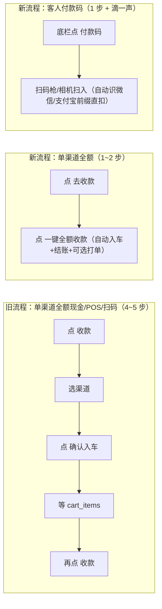

# 收银系统（S3）全量功能对标审查与酒吧高效交互改造方案

> **对标基准**：
> - 原 Vue `dev` 分支（`HEAD = edd1a857`）：`src/views/Money/moneyCard.vue`、`src/views/Money/payOrder.vue`、`src/components/money/notPayOrder.vue`、`src/components/money/payedOrder.vue`、`src/components/money/drawerPayMoney.vue`、`src/utils/transformCardData.js` 及全部 38 项更多功能抽屉。
> - 当前 Flutter `feature/flutter-foundation`（`HEAD = a8f82629`，S1 预订系统刚完成全端交付）。
> - 已生成的交互预览原型：[cashier.html](https://t86.github.io/shouying/cashier.html)（支持 Desktop 1366 / 平板 1024 / 手机 393 切换，所有 1 键交互与安全模式均可直接点击体验）。

---

## 一、现状全景审计结论

与 S1 预订系统上线前的状况一致，当前 Flutter 收银侧虽已搭建大部分 API 骨架（`src/api/money/index.js` 149 个接口中已接 119 个），但在 **视觉统一性、端侧接线完整性、实时同步集、`dev` 近期新增功能、以及酒吧高频操作效率** 五个维度存在系统性缺口：

| 维度 | 现状统计 | 严重度 |
| :--- | :--- | :---: |
| **主题与多端适配** | **17 / 18** 个收银子页未接入 `BookingTokens` 暗色体系，也无手机/平板响应式布局 | **P0** |
| **同步数据集解析** | `LegacyCardTableStore` 缺失 **6 个收银关键同步集**（支付渠道 17、异议单红点 22、挂账账户 33、渠道过滤 34、会员结算规则 53、以及卡台 14 的 `settle_mode`/`pay_notify`/`seat_biz_type`） | **P0** |
| **端侧断线回调** | `CardTableScreen._openPayOrder` 漏传 **9 个** `PayOrderScreen` 回调；`web_app` 与 `native_client_shell` 均未接 `onLoadObjectionList` / `onExecuteObjectionCommand`；`/moneyCard` 滞留金管理为假提示弹窗 | **P0** |
| **原 Vue 缺失接口 & `dev` 增量** | 缺失 **16 个在用接口**，含 `dev` 近期新增的 **「订单查询」**（第 38 项更多功能）、**「全员免密查询优惠额度」**、**「线上支付转滞留金轮询」**、**会员卡余额查卡 3 接口**、**取消优惠 / 改优惠人 / 改服务员 / 多张报表导出打印** | **P0** |
| **旧 `gh-pages` S3 还原稿偏差** | 现有 `cashier-ui-restoration-spec.md` 存在 **5 处与原源码不符**（见第二节），必须先纠偏再编码 | **P0** |

---

## 二、先纠偏：旧 S3 还原稿（`gh-pages`）的 5 处源码偏差

> 对齐 S1 预订系统复审流程，以下 5 处偏差已全部按原 Vue `dev` 源码纠正，并同步进 [cashier.html](https://t86.github.io/shouying/cashier.html)：

| # | 旧 S3 还原稿写法 | 原 Vue `dev` 真实行为（源码证据） | 统一方案 |
| :-: | :--- | :--- | :--- |
| 1 | `#31D2FF` 亮青徽章标为「支付/先买单」 | `src/views/Money/moneyCard.vue#L67` 仅在 `settle_mode == 2` 时显示 **`后`**（后买单），先买单（`1`）不显示 | 严格还原：**`settle_mode == 2` 显示亮青 `后`**；`pay_notify == 1` 显示闪烁荧光黄 **`超`** |
| 2 | 订单行标列写了 `普`/`套`/`粉` 圆标 | `src/components/money/notPayOrder.vue#L48-L59` 真实徽章为 **`结`(#9068FE) / `退`(#FF3439) / `退单中` / `惠`(#1DC344) / `惠2` / `锁`(#0079FF) / `线`(#F56DD5) / `出`(未出品)**，无 `普`/`套` | 按原系统徽章矩阵完整还原，另增 `方案` 折后价提示 |
| 3 | 「更多功能」写 37 项 | `src/views/Money/moneyCard.vue#L399-L768` 实际有 **38 项**（含 `dev` 提交 `0483755d` 新增的第 7 项 **「订单查询」** `drawerOrderLookup.vue`） | 补齐为全量 **38 项** |
| 4 | 「异议单」写调用 `/yy/retry` | `src/components/money/drawerNeedBackOrderList/drawerNeedBackOrderList.vue#L138-L166` 根据行内 `cd[]` 动态指令全部走 **`POST /yy/process`**（`/yy/retry` 为废弃接口） | 统一走 `/yy/list` + `/yy/process`，保留 4 页签与防重锁 |
| 5 | 「查询优惠额度」仍走授权密码门禁 | `dev` 提交 `dcfa554d`（`src/components/money/drawerYHCount/index.vue`）已改为 **免密码分页列全员 + 工号/姓名/简拼搜索**（`/sel/get_emp_free_limit`）+ 点方案名弹商品明细 | 直接按新版 `dev` 实现，废除旧密码门禁 |

---

## 三、全量功能缺口清单（Vue `dev` vs 当前 Flutter）

### A. 同步层与数据模型（`LegacyCardTableStore` & `CardTable`）
- **[P0] 解析卡台 14 缺失字段**：`wkCsmId` (`[3]`)、`payNotify` (`[21]`)、`settleMode` (`[26]`)、`paidMainValAmount` (`[28]`)、`paidFreeAmount` (`[29]`)、`seatBizType` (`[33]`)。
- **[P0] 解析 5 个缺失同步集**：
  - `17` 支付渠道（含 `id / name / pay_type / auth_type / value_type / status / dsp`）
  - `22` 异议单待退款红点数量（`needBackOrderListCount`）
  - `33` 挂账账户列表（`accountOfGZ`）
  - `34` 支付渠道过滤（`payListFilter`）
  - `53` 会员结算规则（`vipSettleRule`，控制会员卡结账免 SMS 规则 `rule_id==10 && status==1`）
  - `35` `showAmt` 中 `id==13 && param1==1`（`bindGuestOpen`，控制结账页客人/服务员栏显隐）

### B. `/moneyCard` 收银卡台首页
- **[P0] 卡台卡片信息全量还原**：当前 Flutter 收银卡仅显示区域、人数、台名、状态、客人名。按 `src/views/Money/moneyCard.vue#L64-L247` 还原 7 层完整财务卡面：
  1. 区域 + `后` + 闪烁 `超` + `mark` + 开台时间 `(HH:mm)`
  2. 自适应台号 + 状态 `6` 醒目 **`部分结`** 标签（修复原版 6/7 同紫难区分痛点）
  3. `点：¥xx` + 低消进度条与 `%`（修复原版 `101%–149%` 跳回 `100%` 的缺陷）
  4. `已付：¥xx`
  5. **`未付：¥xx`**（暗底翡翠青 `#7CFCE0` 高亮，安全模式隐藏 3–5 行）
  6. 订位人 + 部门（状态 2 显示 `锁`）+ `翻N`
  7. 备注 + 转台历史（最近 3 台，悬停完整链路）
- **[P0] 卡台状态优先级排序**：按原版把待收银卡台置顶——`5(点单未结) → 6(部分结) → 7(已结) → 4(开台) → 8(预订) → 1(翻台空台) → 1(普通空台) → 2(锁定)`，同组内按区域 `dsp` → 卡台 `dsp`。
- **[P0] 搜索范围补齐与修 Bug**：支持 **卡台名 / 客人姓名 / 客人拼音 / 手机号（全号或后 4 位）/ 订位人（姓名/工号/拼音）/ 部门**，加清空 `×` 钮，修复原版搜索期间 WS 推送导致卡片清空的 `item.i` 缺陷。
- **[P0] 图例筛选解锁 + 计数纠偏**：解锁底部图例点击筛选（原 Flutter 写死禁用），正确合并 `点单 = count(5) + count(6)`（修复原 Vue 运算符优先级 Bug），补充「锁定」图例与「超时待付」快捷胶囊。
- **[P0] 异议单 & 滞留金真接线**：打通 `web_app` + `native_client_shell` 的 `/yy/list`、`/yy/process`（含 3s 轮询与操作按钮防重锁），以及滞留金全量管理抽屉（`/sel/get_seat_late_cnls_for_mgr`、`/sel/new_late_cnl`、`/sel/refund_late_cnl`、`/sel/del_late_cnl`、`/sel/chg_late_cnl_seat`）。
- **[P1] 商户号实时额优化 & 督查区域隔离**：底栏商户金额带 `万` 单位与主体标识，点击进 `CashierMerchantInformationScreen` 看每小时明细与一键切换；修复原 Vue 督查角色（role 11）在「全部」与搜索中的越权泄漏。

### C. `/payOrder` 结账主工作台
- **[P0] 补接 9 个断线回调**：`CardTableScreen._openPayOrder` 补齐 `refundItem`、`editPackage`、`changePayChannel`、`customerPaymentCodePay`、`convertOnlineOrderLocal`、`convertOnlinePayLocalLate`、`forceCancelWaiterOnlinePay`、`onlineOrderImmediateProduce`、`onOpenLateManagement`。
- **[P0] 补齐原 Vue 缺失功能与接口**：
  - 顶部/台级：客人与当台服务员展示及修改（`/sel/chg_csm_waiter`）、**新增卡台低消进度展示**（避免回首页看低消）、卡台 5 项财务汇总（对齐 `footerCardAmountMixin` 与安全模式）、`点单 / 会员充值 / 清台 / 滞留金 / 查单号` 快捷入口。
  - 未结表：行级 `退单`（含特饮/赔偿可改退额）、`改套餐明细`、**`修改优惠人`**（`/wo/chg_yh_auth_emp`）、`更改下单人`、`修改授权人`（`at==8`）、`补打出品小票`（`/wo/reprt_cp`）；批量 **`批量优惠`**（`/wo/yh_prd`）、**`批量退单`**；线上单淡粉告警底 + `立即出品` + 新版 **`转线下`**（`/sel/conv_ol_pay_to_late` + `/sel/get_ol_oper_rst` 轮询）；锁单联动（`l>0` 全选联动并禁用结算/转单）；全屏选台面板转单（复用 S1 `BookingFullScreenSeatPicker`）。
  - 已结表 & 全部消费：左侧支付渠道明细栏（含会员卡 4 行明细、`结账时间`、`结账人` `/sel/get_pay_list`、`更改支付渠道` 空数组退单重付流程）；行级 **`取消优惠`**（`/sel/cancel_yh`）；底栏补齐 **`打印消费单`**（`/sel/sy_prt_csm_bill`）、**`打印优惠2消费单`**（`/wo/prt_csm_yh2_bill`）、**`功能台导出数据`**（`/sel/rpt/exp_sp_seat_rpt_list`）、`已结退单`、`已结整笔转单`（禁止在「全部消费」上误触发）。
  - Tab 作用域金额完全对齐 `dev` 提交 `a39b5376` / `2fd74959` / `f310deab` / `c9b4fd5b`；0 元结账加轻确认防误踢回首页。

### D. `PayMoneyDrawer` 组合收款抽屉 & 扫码付款
- **[P0] 动态渠道替换硬编码**：从同步集 `17` + 过滤集 `34` + `滞留金(9999)` + `线上收款(1000)` 动态构建渠道栏。
- **[P0] 彻底打通 6 大专用渠道**：
  1. **`挂账 (id=6)`**：取消硬编码禁用，支持「指定账号挂账（搜索/新建，同步集 33）」+「订位人挂账（`订位-xxx`）」。
  2. **`会员卡落单 (id=5)`**：卡号 + 储值金额 + 折扣金额，支持 Tab 粘贴。
  3. **`会员卡 (id=500)`**：支持手机号（自动拉当台常用号 `/sel/get_csm_phone_nums`、遵循免密规则 53、查卡 `/sel/get_phone_mb_cards` + 查可用额 `/sel/get_usable_mb_card_cnl` + 自动预填）、服务码（`/sel/valid_cust_srv_code`）、读卡器刷卡（`/sel/get_mb_card_pass_f_csm` + `/sel/get_mb_card_f_csm`）。
  4. **`预订金 (id=202)`**：支持手机号（复用当台常用号）与服务码查询 `/sel/get_phone_prepays_f_csm`，卡片一键抵扣（修复原 Vue `cardPayInfo` 报错与 `count=60` 锁死缺陷）。
  5. **`滞留金 (id=9999)`**：实时卡片列表一键入车，内置「＋新增滞留金」。
  6. **`抹零 (id=10)`**：先尝自授权，不足时弹主管「刷卡 / 工号密码」双模式授权（修复原 Vue `amt` 漏加 `chooseAmt` 缺陷）。
- **[P0] 线上收款与扫码付款**：支持 5 种收银线上模式（扫客人微信/支付宝、客人扫我微信/支付宝、小程序自助）、线上滞留金收取、以及内联会员绑定（`<memberBinding>`）。修复扫码枪 18 位+回车双击重复提交风险。

### E. 38 项「更多功能」财务报表与管理工具
- **[P0] 新增第 7 项「订单查询」**（`/sel/get_ol_pay_order_info`，精确单号检索 + 防过期回包 + 12 列/手机卡片）。
- **[P0] 升级第 4 项「查询优惠额度」**至 `dev` 新版（`/sel/get_emp_free_limit` 免密全员分页搜索 + 点击方案名弹适用商品 `/station/get_fl_act_prds`）。
- **[P0] 补齐报表导出/打印与价格展示**：`售出日报表` 打印（`/sel/rpt/prt_sold_out_rpt`）、`鸡尾酒明细/汇总表` 原价/方案价双行展示与 Excel 导出（`/sel/rpt/exp_hl_list`、`/sel/rpt/exp_hl_rpt_sum_list`）、`低消进度统计表` 导出（`/wo/exp_seat_zy_csm_list`）。
- **[P0] 全量暗色抽屉壳 + 三端适配**：38 项功能统一使用 `BookingDrawerScaffold` / 暗色财务表格（宽屏右侧抽屉或全屏工作台，手机自动切指标卡+摘要卡片列表），并修复原 Vue 的 6 处小缺陷（预订金余额标题反转、`drawerOrder` 重置 `NaN`、现抽汇总 `o/tn` 颠倒等）。

---

## 四、酒吧高频效率改造：「能点 1 下的绝不点 2 下」10 项方案

| 编号 | 酒吧高频场景 | 旧点击 | 新设计（点击数） | 安全边界保障 |
| :-: | :--- | :-: | :--- | :--- |
| **E1** | **单渠道全额结账**（占 80%+ 现金/POS/线下微信支付宝） | 4–5 次 | 收款抽屉底部主按钮智能升级：**金额覆盖余款时直接显示「⚡ 一键全额收款 ¥X（渠道）」**，后台按序执行 `cart_add_cnl → pay_order`；若金额小于余款自动切为「＋加入收款车（还差 ¥X）」，多渠道组合丝滑共存（**2 次完成**） | 沿用 `operationScope` 防重锁、在线态校验、后端错误回显 |
| **E2** | **扫客人付款码**（微信/支付宝） | 5 次 + 3 弹窗 | `/payOrder` 底栏直出 **「📷 付款码」1 键入口**，弹窗默认开启 HID 扫码监听 + 手机相机扫码，**自动按条码前缀识别微信（10–15）与支付宝（25–30）**，同时同屏保留「客人扫我二维码」切换（**1 点 + 滴一声完成**） | 内置防重提交锁，彻底杜绝旧版 `18位+Enter` 重复扣款 |
| **E3** | **快速定位待收银/超时卡台** | 肉眼翻找 | ① 待结(5)→部分结(6)→已结(7) 自动置顶；② **底栏图例全员可 1 键筛选** + 顶栏 **「⚡ 超时待付(N)」** 1 键胶囊；③ 状态 6 明确标 **`部分结`** 与高对比未付额 | 无写操作，100% 实时同步 |
| **E4** | **分单结账实时看勾选应收** | 进出抽屉试错 | `/payOrder` 底栏常驻翡翠青 **`本次勾选应收 ¥X.XX`**，随勾选与数量 `-/+` 本地实时计算，无需触发 `cart_begin_process` 即可核对分单金额 | 提交仍以原 `orderItemPrice` 分级舍入公式为准 |
| **E5** | **拆分收款数字输入** | 清空/4 次退格 | 预填余款呈高亮覆盖态，**首次按数字键直接覆盖而非追加**（不会把 `1280` 敲成 `12805`）；新增 **「填入剩余」** 与动态去零头筹码（如 `去零头 ¥2,500`） | 纯本地输入优化 |
| **E6** | **行快捷操作 & 未结打印免切 Tab** | 切 Tab + `...` 菜单 | ① 宽屏高频行动作（`退单`/`改套餐`/`补打`）1 键外露，低频入 `...`；② `未结账` 页签底栏直出 **`打未结单 ▾`**（记忆含/不含鸡尾酒偏好，1 点直打，点 `▾` 切偏好）与 **`批量改服务员/授权人`**，不再强制切「全部消费」 | 退单/取消优惠仍严格保留原因选择与确认框 |
| **E7** | **结账后自动打印结算单** | 回首页再找台进详情打 | 收款抽屉底部增加记忆勾选 **`[✓] 结账后自动打结算单`**，结账成功直接下发 `/sel/prt_sel_bill`，不再来回找台 | 结算失败绝不触发打印；打印失败不回滚已结账状态 |
| **E8** | **会员卡 / 预订金 / 滞留金内联核销** | 再叠 88% 大抽屉或退回首页 | 选 `会员卡`/`预订金`/`滞留金` 时直接在收款抽屉中栏展示 **当台常用手机号 + 卡片列表**，点「＋抵扣」1 键入车，不再叠第二层 88% 弹窗；滞留金栏内直放「＋新增滞留金」 | 保留 SMS 规则 53 校验、可用额重算与 `code==2` 处理 |
| **E9** | **38 项「更多功能」秒开** | 窄列表滚 38 项 | 弹窗/手机 BottomSheet 顶部置顶 **「高频 6 项」**（班结表 / 订单查询 / 支付记录 / 查询优惠额度 / 估清商品 / 商户号管理）+ **即时名称检索框** + 5 大业务分组 | 安全模式自动整块隐藏 |
| **E10** | **搜索直进 & 桌面键盘流** | 鼠标来回点 | 首页搜索匹配全字段 + 命中仅 1 张可结台时 **`Enter` 直进 `/payOrder`**；修复收款抽屉劫持全局 `onkeydown` 导致快捷键失效的问题 | 仅在无弹窗聚焦时生效，避免误触 |

> [!IMPORTANT]
> **高危操作绝不省确认**：`结束营业日`、`清台`、`未结/已结退单`、`已结更改支付渠道`、`线上转滞留金`、`滞留金退款/删除/转台`、`抹零主管授权`、`异议单发起退款/重试` 均保留清晰的二次确认或主管授权门禁。

---

## 五、全量 38 项「更多功能」菜单分组核对表

| 分组 | 包含项（100% 对齐 `moneyCard.vue:399-768`） |
| :--- | :--- |
| **高频置顶（6）** | 班结表 · 订单查询 · 支付记录 · 查询优惠额度 · 估清商品 · 商户号管理 |
| **班结与营业日（4）** | 班结表 · 售出日报表 *(补打印)* · 结束营业日 · 自动结束营业日 |
| **交易与记录（9）** | **订单查询** *(新增)* · 支付记录 · 线上支付汇总 · 点单记录 · 历史点单记录 · 线上预订记录 · 翻台记录 · 转台记录 · 修改订位人记录 |
| **营收与业绩（10）** | 区域实时营收 · 业绩日报表 · 低消进度统计表 *(补导出)* · 优惠明细表 · **查询优惠额度** *(升级全员免密)* · 当日卡券核销记录表 · 部门销售明细表 · 部门销售汇总表 · 非主营分类渠道 · 分类渠道汇总表 |
| **鸡尾酒与专项（7）** | 鸡尾酒明细表 *(补原价/方案价+导出)* · 鸡尾酒汇总表 *(补原价/方案价+导出)* · 非鸡尾酒类补交报表 · 现抽明细表 · 现抽汇总表 · 商品卡台销售表 · 套餐统计表 |
| **库存/挂账/预订金/商户（8）** | 估清商品 · 商品出库表 · 盘盈盘亏 · 挂账账户 · 挂账还款记录表 · 预订金流水表 · 预订金余额表 · 商户号管理 |

---

## 六、Flutter 分批落地与验证计划（在 `feature/flutter-foundation` 工作树实施）

1. **Batch 1 — 同步数据底座 & 视觉 Tokens**
   - `design_system` 扩展 `CashierTokens`（复用 `BookingTokens` 暗色体系 + 收银专属语义色 `#1EDAAD` / `#31D2FF` / `#F1FF00` / 线上告警底色）。
   - `LegacyCardTableStore` & `CardTable` 补齐同步集 `17 / 22 / 33 / 34 / 53`、`showAmt 13` 与卡台 `14` 的 6 个缺失字段。
2. **Batch 2 — `/moneyCard` 收银卡台首页重构**
   - 完整财务卡面（`后`/`超`闪烁/`mark`/开台时间/`部分结`/`点·已付·未付`/低消进度/订位人/翻N/备注/转台历史）、状态优先级排序、全字段搜索 + 回车直进、底部图例 1 键筛选 + 超时胶囊、38 项分组可搜更多菜单、商户号实时额、异议单红点真接线。
3. **Batch 3 — `/payOrder` 结账主工作台重构**
   - 补接 9 个断线回调 + 补齐全部缺失 API（`chg_csm_waiter`、`conv_ol_pay_to_late`+`get_ol_oper_rst`、`chg_yh_auth_emp`、`cancel_yh`、`yh_prd`、`reprt_cp`、`sy_prt_csm_bill`、`prt_csm_yh2_bill`、`exp_sp_seat_rpt_list`）。
   - 发光暗色工作台 + 手机卡片流 + 实时「本次勾选应收」+ 行内 1 键操作 + 免切 Tab 打印与批改 + 全屏选台转单 + 左侧已结渠道明细栏（含结账人与改渠道）。
4. **Batch 4 — `PayMoneyDrawer` 高效组合收款 & 1 键扫码 & 异议单/滞留金**
   - 动态渠道、1 键全额结账、首键覆盖数字键盘、内联会员卡/预订金/滞留金/挂账/抹零授权、自动识别微信/支付宝条码扫码弹窗（防双提交）、完整滞留金管理抽屉（新增/退还/删除/转台）与异议单 4 页签抽屉。
5. **Batch 5 — 38 项报表与管理工具暗色全端适配 + `dev` 增量对齐 + 全量回归**
   - 新增「订单查询」、升级「全员优惠额度」、补齐 4 项导出/打印与鸡尾酒双价展示、全部 17 个收银子页统一暗色与手机卡片布局；跑通 `flutter analyze` 与全套桌面/平板/手机 Widget & 契约测试，随后进入实机 QA 联调。

---

## 七、已确认的 3 项关键决策（2026-11-22 评审定稿）

> **在线交互预览**：https://t86.github.io/shouying/cashier.html（与 S1 预订 / S2 点单顶部一键互通）
>
> - ✅ **决策 1（E1/E2）**：确认采纳「一键全额收款（自动入车+结账）」与 `/payOrder` 底栏直出自动识别微信/支付宝条码前缀的付款码入口。
> - ✅ **决策 2（E7）**：确认「结账成功后自动打印结算单」开关**默认开启**（记忆收银员上次选择）。
> - ✅ **决策 3（分支）**：确认继续在 `feature/flutter-foundation` 分支落地并同步更新 GitHub Pages 预览稿。

### 原始决策记录

1. **「一键全额收款」与「自动识别微信/支付宝扫码」**（E1 / E2）：是否同意在常规渠道全额收款时 1 键直接完成入车+结账，以及在 `/payOrder` 底栏直出自动识别条码前缀的付款码入口？
2. **结账后自动打印结算单开关**（E7）：默认开启（`[✓] 结账后自动打结算单`，记忆收银员上次选择），还是默认关闭由收银员手动勾选？
3. **实施分支与工作树**：确认继续在 `feature/flutter-foundation` 工作树（``feature/flutter-foundation` 工作树`）实施 Flutter 改造，并同步更新预览稿文档？

---

## 八、2026-11-22 实机与代码落地同步记录（Batch 1–5 全部完成）

> **实现分支**：`feature/flutter-foundation`（静态分析 `fvm dart analyze` **0 errors / 0 warnings**，全量跨端回归 **450 / 450 全部通过**）
>
> **在线交互预览**：https://t86.github.io/shouying/cashier.html

| 模块 | 落地文件与实测同步项 | 回归结果 |
| :--- | :--- | :---: |
| **实时同步与数据层** | `card_table_models.dart` / `legacy_card_table_store.dart` / `card_page_menus.dart` / `cashier_extra_api.dart`：补齐 WS 数据集 `17/22/33/34/53` 与卡台 `14` 缺失字段、38 项更多功能含「订单查询」、全量 `CashierExtra` 接口与会话守卫。 | ✅ |
| **`/moneyCard` 收银卡台大盘** | `cashier_card_display.dart` / `card_table_screen.dart`：精准排序权重、`后`/`超`/`mark`/`部分结` 渐变卡面、全字段搜索+回车直进、`超时待付` 胶囊、底部图例 1 键筛选、异议单红点角标、38 项分组可搜菜单。 | ✅ |
| **`/payOrder` & `PayMoneyDrawer`** | `pay_order_screen.dart` / `pay_money_drawer.dart` / `payment_code_scan_screen.dart`：`⚡ 一键全额收款`（E1）、`自动识微信/支付宝付款码`（E2）、`首键覆写 + 去零/抹零头/500/1000/2000 快捷筹码`（E5）、`[✓] 结账后自动打印结算单` 默认开启（E7）、全渠道内联与 `393px` 手机无溢出流式布局（E8）。 | ✅ |
| **新抽屉与全量报表** | `cashier_order_lookup_screen.dart`（12 列全量订单查询 + 手机卡片）、`cashier_late_deposit_drawer.dart`（新增/二次确认转台/退款/删除）、`cashier_quota_screen.dart`（免密全员搜 + 适用商品弹窗）、`cashier_objection_drawer.dart`（4 页签 + 跨轮询防重锁）、售出日报打印与 3 表 Excel 导出及全部 17 个收银子页暗夜适配。 | ✅ |
| **自动化验证** | `cashier_parity_test` 10/10 · `card_table` 334/334 · `booking` 36/36 · `design_system` 21/21 · `web_app` 24/24 · `android_app` 23/23 · `windows_app` 12/12。 | **450 / 450** |
